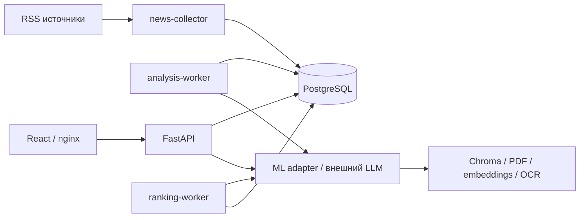

# Архитектура и модель данных

Состояние исходников: 26.10.2026.

raw_companies хранит исходные профили JSONB; raw_payments — направленные платежи, суммы и количество; raw_person_links — связи лиц и компаний. Они образуют контекст компании.

news хранит текст, дату, источник, content_hash и признак синтетики. analyses связывает компанию, роль и news_id, хранит статус, результат, попытки и ключ идемпотентности. analysis_steps содержит трассу попытки. news_relevance имеет составной ключ компания/роль/новость. conversations связана с разбором, chat_messages хранит сообщения, ссылки на основания и состояние ответа.

Точный DDL: backend/db/schema.sql и mvp.sql; обновление старой версии — upgrade_mvp_v2.sql. Типы HTTP-контракта: backend/app/schemas, маршруты: backend/app/api/routes. Актуальный OpenAPI генерируется приложением на /openapi.json.

X-Company-ID ограничивает демо-контекст, но не заменяет аутентификацию. API валидирует результаты и источники; ML вызывается в отдельном процессе с таймаутом. Синтетический Compose использует тестовый адаптер, отдельный volume и только loopback-порты. Обычный режим требует внешних данных и конфигурации провайдера.
